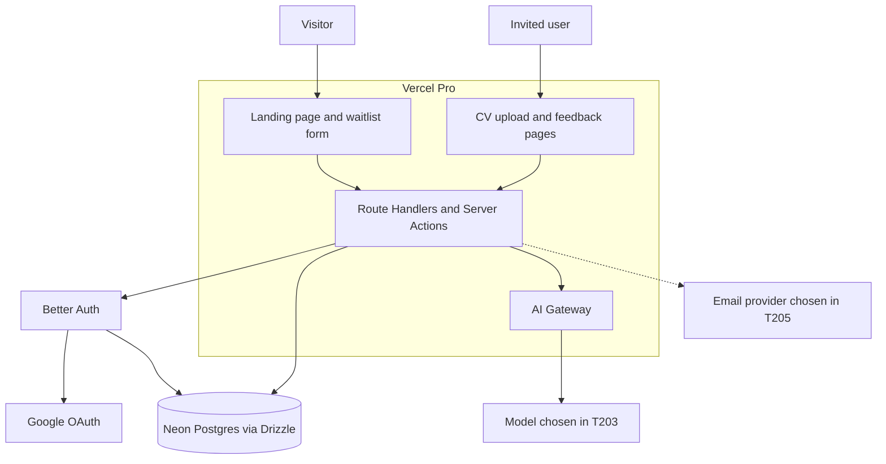
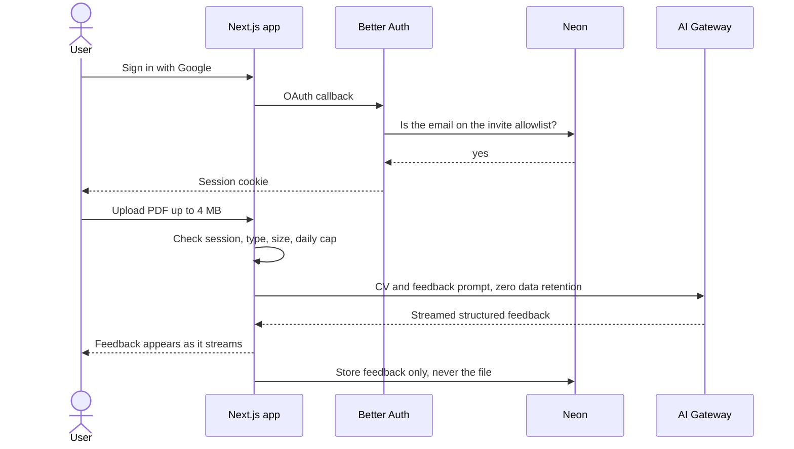
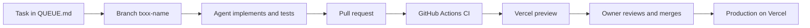

# Architecture

## System overview

One Next.js application on Vercel serves the public landing page and the
signed-in tool. The database holds four kinds of rows: waitlist entries,
users and sessions (Better Auth), the invite allowlist, and review results.
The uploaded CV exists only in memory during the request: it is passed to
the model through the AI Gateway and then discarded. Email is added at the
end of week 2 for invites.

## Core flow

## Development workflow

## Environments

| Environment | Purpose | Where it runs | Data |
|-------------|---------|---------------|------|
| Local | development | `next dev` on the builder's machine | Neon development branch, synthetic CVs only |
| Preview | per pull request | Vercel preview deployment | Neon development branch, synthetic CVs only |
| Production | real users | Vercel production | Neon main branch |
