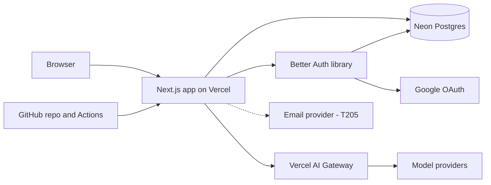

# Stack fit

*Quick depth: edges checked against the sources fetched in this run; edges
marked `UNVERIFIED` are re-checked in the task named.*

## Integration map

## Integration edges

| Edge | Official integration | Caveats / known issues | Verdict | Sources |
|------|---------------------|------------------------|---------|---------|
| Next.js ↔ Vercel | native target | none for this scope | ✅ | [S3][S4] |
| Upload ↔ Vercel Functions | Route Handler | 4.5 MB request body limit → cap CVs at 4 MB, check size in the browser too | ⚠️ | [S4] |
| AI call ↔ function duration | streaming responses | 300 s default and maximum on Hobby, up to 800 s on Pro; waiting on the model is not active CPU | ✅ | [S4] |
| App ↔ AI Gateway ↔ providers | AI SDK + gateway | free tier = subset of models with lower rate limits → buy credits before T203; PDF file input per provider through the gateway `UNVERIFIED` → T202 checks it, fallback: extract PDF text on the server | ⚠️ | [S5] |
| Better Auth ↔ Drizzle ↔ Neon | Drizzle adapter | tested with Drizzle 0.45; Neon serverless driver specifics `UNVERIFIED` (T201) | ✅ | [S12][S14] |
| Better Auth ↔ Google OAuth | built-in social provider | needs a Google Cloud OAuth client and consent screen (`UNVERIFIED` review time for public apps — start in T001) | ⚠️ | [S12] |
| Vercel ↔ Neon | Vercel Marketplace integration | not verified in this run; fallback is a direct Neon account and a `DATABASE_URL` env var | ⚠️ | — |
| Region alignment | — | Vercel functions default to `iad1` (US East) [S4]; create the Neon project in a US East region to match | ✅ | [S4] |
| GitHub ↔ Vercel | Vercel Git integration | preview deployment per PR assumed; `UNVERIFIED` in this run (T003) | ⚠️ | — |

✅ documented and common · ⚠️ works with caveats · ❌ blocker (replaced)

No blockers found.

## Reference implementations

- MakerKit's Next.js + Drizzle + Better Auth kit documents the auth/ORM
  combination [S14] (a commercial starter — useful as reading, not needed as
  a dependency).
- No vendor-maintained template combining all of Vercel + Neon + Better Auth +
  AI Gateway was verified in this run.

## Whole-package findings

1. **Vendor count: 3 bills** (Vercel incl. AI tokens, Neon, email provider)
   plus free accounts at GitHub and Google Cloud. Billing Neon through the
   Vercel Marketplace would make it 2 (`UNVERIFIED`).
2. **Cost coupling:** every review is one AI call — the AI bill scales
   linearly with usage, so the per-user daily cap and the gateway budget
   are part of the design, not an afterthought.
3. **Single point of failure:** Vercel (hosting and AI access). Acceptable
   for an MVP; the AI SDK can point to a provider directly if the gateway
   fails.
4. **Lock-in: low.** Postgres + an open-source auth library + a standard
   Next.js app; the hardest part to leave is Vercel-specific configuration.
5. **Skill fit:** one language (TypeScript), one framework the builder knows.
6. **Local development:** everything runs locally with `next dev` against a
   Neon development branch and a development gateway key.
7. **Backup / export:** Neon restore window is 6 hours on Free and up to
   7 days on Launch [S9] → move to Launch before real users; a restore is
   tried once in T206.
8. **Licence chain:** Next.js (MIT), Better Auth (MIT), Drizzle (Apache-2.0)
   — `UNVERIFIED` in this run; re-check in T206. All compatible with a
   closed commercial product if confirmed.
9. **Security chain:** the GitHub and Vercel logins reach everything — MFA on
   both is T001.

## Sub-processors of personal data

| Service | Data processed | Region | DPA |
|---------|---------------|--------|-----|
| Vercel | all requests, logs, uploaded CV in memory | US (iad1) [S4] | `UNVERIFIED` — T206 |
| Neon | waitlist emails, users, review results | US East (chosen) | `UNVERIFIED` — T206 |
| AI provider chosen in T203 (via AI Gateway) | CV content and feedback | provider's global routing | gateway ZDR per request [S5]; provider DPA `UNVERIFIED` — T206 |
| Google | sign-in identity | Google | Google's terms — `UNVERIFIED` |
| Email provider (T205) | waitlist emails | TBD | TBD |
