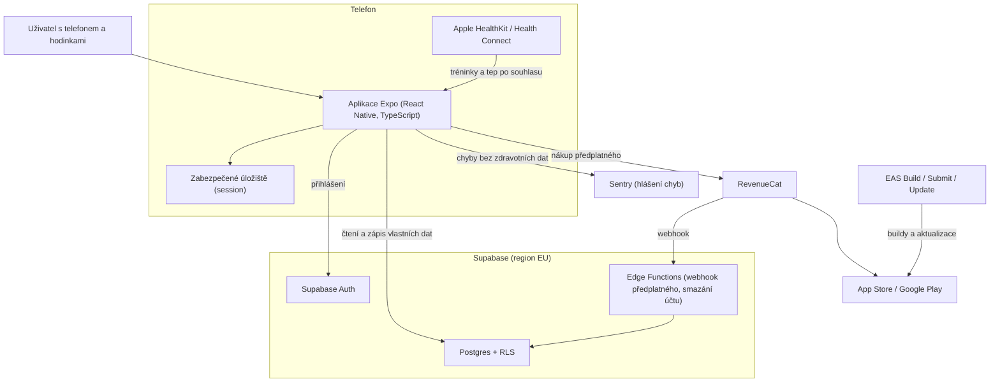
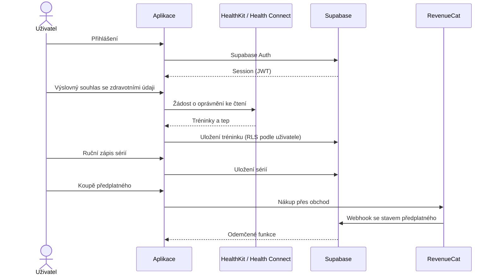
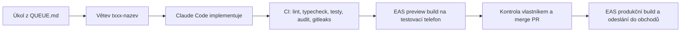

# Architektura

## Přehled systému

Aplikace v telefonu čte data z Apple Health / Health Connect až po
výslovném souhlasu a ukládá je spolu s ručně zapsanými tréninky do Supabase.
Řádková bezpečnost (RLS) v Postgresu pustí každého uživatele jen k jeho
řádkům. Předplatné kupuje uživatel v obchodě přes RevenueCat; RevenueCat
pošle změnu stavu webhookem do Edge Function, která ji zapíše do databáze.
Buildy a vydání do obchodů obstarává EAS.

## Hlavní tok

## Vývojový postup

## Prostředí

| Prostředí | Účel | Kde běží | Data |
|-----------|------|----------|------|
| development | vývoj a testy na vlastním telefonu | development build z EAS + Supabase projekt `dev` (Free) | jen testovací data |
| preview | testeři (TestFlight / interní testování Google Play) | EAS preview build + Supabase `dev` | testovací data testerů, bez produkčních |
| production | platící uživatelé | obchody + Supabase projekt `prod` (Pro, EU) | skutečná zdravotní data — agent sem nemá přístup |
