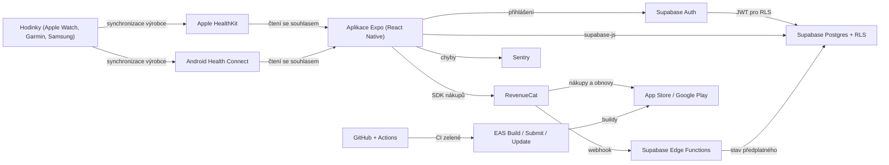

# Jak stack drží pohromadě

## Mapa integrací

## Hrany integrací

| Hrana | Oficiální integrace | Výhrady / známé problémy | Verdikt | Zdroje |
|-------|---------------------|--------------------------|---------|--------|
| Hodinky → HealthKit / Health Connect | ano (aplikace výrobců) | Garmin → Apple Health: u tréninků jen min./max. tep, bez GPS [S17]; Garmin → Health Connect: kroky, tep, spánek, váha (od GC 5.14.1) [S18] | ⚠️ | [S17][S18] |
| HealthKit / Health Connect → Expo | knihovny s Expo pluginem | nefunguje v Expo Go — nutný development build; min. Expo SDK 53, iOS 16.4, Android 8 [S5]; Health Connect vyžaduje v Google Play deklaraci zdravotních oprávnění (`UNVERIFIED`) | ⚠️ | [S5][S6] |
| Expo → Supabase | `supabase-js`, oficiální návod pro Expo (`UNVERIFIED`) | funguje i v Expo Go [S19]; uložení session do zabezpečeného úložiště | ✅ | [S19] |
| Supabase Auth → Postgres RLS | nativní | RLS je třeba zapnout na každé tabulce a otestovat | ✅ | [S11] |
| Expo → RevenueCat | SDK pro React Native (`UNVERIFIED`) | potřebuje development build; testovat v sandboxu obchodů | ⚠️ | [S10] |
| RevenueCat → Supabase Edge Function | webhooky (`UNVERIFIED`) | ověřovat autorizační hlavičku webhooku, zpracování idempotentně | ⚠️ | — |
| RevenueCat → obchody | oficiální | provize 15 % (Small Business Program) [S13]; v EU od 1. 10. 2026 volba platebních možností drženě 12 měsíců [S13] | ✅ | [S13] |
| GitHub → EAS | EAS umí build z CI i ručně z příkazové řádky | Free plán: 15 + 15 buildů/měs., nízká priorita fronty [S12] | ✅ | [S12] |
| EAS → obchody | EAS Submit | vyžaduje účty Apple Developer (99 $/rok) a Google Play (25 $) [S14][S15]; nový osobní účet Google Play — pravidlo uzavřeného testu s testery [S15] | ⚠️ | [S14][S15] |
| Aplikace → Sentry | SDK pro React Native (`UNVERIFIED`) | do hlášení chyb nesmí jít zdravotní data | ⚠️ | — |

✅ zdokumentováno a běžné · ⚠️ funguje s výhradami · ❌ blokující (nahrazeno)

Žádná hrana není blokující.

## Referenční implementace

V tomto běhu nenalezena oficiální šablona kombinující Expo + Supabase +
RevenueCat + HealthKit (quick, nehledáno cíleně). Jako výchozí bod slouží
oficiální generátor `create-expo-app` (viz [SETUP.md](SETUP.md)) a návody
jednotlivých dodavatelů.

## Celkové závěry

1. **Zdravotní data protékají třemi místy** — telefon (HealthKit / Health
   Connect), Supabase a potenciálně Sentry. Do Sentry ani do logů nesmí jít
   nic zdravotního; na Supabase chrání data RLS. Tohle je nejcitlivější
   místo celého stacku.
2. **Počet dodavatelů: 6 účtů** (GitHub, Expo, Supabase, RevenueCat, Apple
   Developer, Google Play) + Sentry. Pro jednoho neprogramátora hodně, ale
   Apple a Google jsou nevyhnutelné a každý další ušetří kód, který by jinak
   AI psala bez revize.
3. **Jediný bod selhání:** Supabase (data + přihlášení + webhooky). Zmírnění:
   zálohy na Pro, export dat pro uživatele, Postgres = přenositelný.
4. **Lock-in:** nejtěžší by byl odchod od RevenueCat (předplatná ale žijí
   v obchodech, ne u RevenueCat) a od Supabase Auth (hesla uživatelů).
   Data samotná jsou v Postgresu — odchod snadný.
5. **Jazyky:** jeden — TypeScript (aplikace i Edge Functions) + trocha SQL
   pro tabulky a RLS.
6. **Lokální vývoj:** aplikace běží na telefonu přes development build;
   Supabase lze spustit lokálně (vyžaduje Docker — `UNVERIFIED`); doporučení:
   samostatný Supabase projekt pro vývoj místo lokálního Dockeru.
7. **Přehled chyb:** aplikace → Sentry; Edge Functions → logy Supabase.
8. **Záloha a export:** Supabase Pro denní zálohy 7 dní [S11]; export dat
   uživatele je úkol T105.
9. **Vazba nákladů:** OTA aktualizace nad 1 000 MAU přepnou EAS na Starter
   (19 $) [S12]; tržby nad 2 500 $/měs. zapnou 1 % u RevenueCat [S10].
10. **Licence:** Expo, React Native a `supabase-js` jsou MIT (`UNVERIFIED`,
    ověřit při T002); u každé knihovny pro zdravotní data zkontrolovat
    licenci před přidáním. Projekt je uzavřený (all rights reserved), copyleft
    (GPL/AGPL) v aplikaci nepoužívat.
11. **Bezpečnostní řetězec:** účet GitHub, Expo, Apple a Google mohou
    vydat aplikaci — MFA na všech je povinná v T001.

## Zpracovatelé osobních údajů

| Služba | Zpracovávaná data | Region | DPA |
|--------|-------------------|--------|-----|
| Supabase | účty, tréninky, tep (zdravotní údaje) | EU (Frankfurt) — `UNVERIFIED`, vybrat při založení projektu | `UNVERIFIED` — stáhnout a podepsat v T001 |
| RevenueCat | anonymní ID uživatele, stav předplatného | `UNVERIFIED` | `UNVERIFIED` |
| Sentry | technické údaje o chybách (bez zdravotních údajů) | `UNVERIFIED` (vybrat EU, pokud je) | `UNVERIFIED` |
| Expo (EAS Update) | technické údaje zařízení při aktualizacích | `UNVERIFIED` | `UNVERIFIED` |
| Apple / Google | nákupy, platby, distribuce | — (samostatní správci) | podmínky obchodů |
